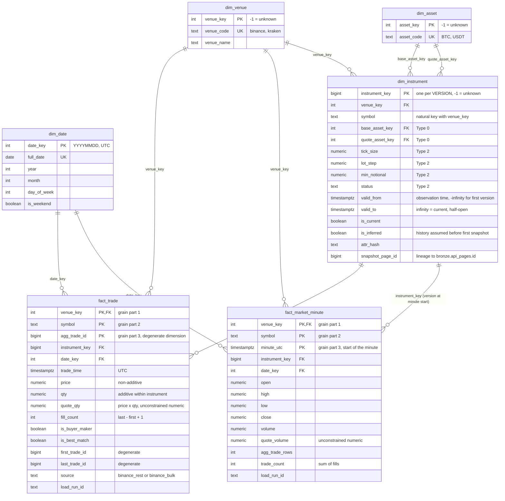

# Dimensional Model — v1

Status: T047 (week 9). Grain, bus matrix, additivity and open questions are fixed here;
the ERD and DDL follow in T051–T052, the SCD2 load in T055.

---

## 1. Business context

The warehouse turns public exchange market data into numbers that can be trusted and
compared. It must answer, reproducibly:

1. **Trading activity over time.** How much traded (base and quote volume, trade counts)
   per instrument, per minute / hour / day?
2. **Price behaviour per minute.** Open, high, low, close and VWAP per instrument and
   minute, rolled up correctly to any coarser period.
3. **Agreement between sources.** Do our trade-level numbers agree with the exchange's
   own one-minute candles — and when they don't, which minutes, by how much, under which
   check?
4. **Point-in-time reference data.** Which instrument rules (tick size, lot step, minimum
   notional, status) applied when a given trade happened?

Cross-venue comparison (Binance vs Kraken) is designed in now and loaded later (W13+).

### Data sources

| Source | Lands in | Content |
|---|---|---|
| Binance REST `/api/v3/aggTrades` | `bronze.api_pages` → `raw.binance_agg_trades` | Incremental aggregate trades from the watermark |
| Binance bulk daily zips (data.binance.vision) | `raw.binance_agg_trades` (backfill) | Historical aggregate trades, from 2024-12-31 |
| Binance 1-minute klines (bulk, week-3 lab) | `raw.klines_1m` | The exchange's own per-minute candles |
| Binance `/api/v3/exchangeInfo` | `bronze.api_pages` | Instrument reference snapshots (filters, status) |
| Kraken `AssetPairs` / trades | — | Not landed yet (STRETCH / LATER) |

### Limitations

- **No user identity.** Public trades carry no account or user id — only the buyer-maker
  flag. User-level analysis is out of scope.
- **Aggregate trades, not fills.** One aggregate-trade row can bundle several fills
  (`first_trade_id`..`last_trade_id`). Row count ≠ trade count.
- **Timestamp precision depends on source.** Pre-2025 bulk files carry milliseconds; REST
  and 2025+ files carry microseconds. Whether bulk truncates or rounds is still open
  (open question 7).
- **Reference history starts at the first snapshot.** Snapshots record *observation*
  time, not the exchange's real effective time; nothing before the first snapshot is
  observed (decision D3).
- **One venue loaded.** Binance only until Kraken lands.

### Layers

| Layer | Tables | Guarantee |
|---|---|---|
| bronze | `bronze.api_pages`, bulk zip files | complete, unmodified, replayable |
| staging | `raw.binance_agg_trades` (schema `raw`) | typed, one row per `(symbol, agg_trade_id)`, first writer wins, lineage |
| silver | cross-venue trades, normalised snapshots (W10+) | conformed keys and units across venues |
| gold | this model | declared grain, history-correct, business-ready |

---

## 2. Enterprise bus matrix

| Business process | Fact table | Fact type | Grain (short) | Date | Time of day ¹ | Venue | Instrument (SCD2) | Asset ² | Recon run |
|---|---|---|---|:-:|:-:|:-:|:-:|:-:|:-:|
| Trade execution | `fact_trade` | Transaction | one aggregate trade | ✓ | ✓ | ✓ (Binance only) | ✓ | via instrument | |
| Market activity | `fact_market_minute` | Periodic snapshot | venue × instrument × UTC minute | ✓ | ✓ | ✓ | ✓ | via instrument | |
| Reconciliation | `fact_recon_minute` | Periodic snapshot (per run) | run × venue × instrument × UTC minute | ✓ | ✓ | ✓ | ✓ | via instrument | ✓ |
| *LATER:* Instrument lifecycle | `fact_instrument_lifecycle` | Accumulating snapshot | one instrument listing | ✓ ×3 roles ³ | | ✓ | ✓ | via instrument | |

**Legend:** ✓ = foreign key in the fact table · *via …* = reached only through another
dimension · blank = not used.

**Test applied to every ✓:** one fact row holds exactly one value of that dimension.

1. `dim_time_of_day` (1,440 rows) is STRETCH. Until it exists, the minute timestamp is
   stored in the fact table.
2. `dim_asset` attaches to `dim_instrument` twice (base, quote): an **outrigger**, not a
   fact-level dimension. Keep or flatten — open question 3.
3. Listed date, first-trade date, delisted date: `dim_date` joined three times from one
   fact — a **role-playing** dimension.

**Conformed dimensions** (✓ in more than one row — one shared table each): `dim_date`,
`dim_venue`, `dim_instrument`. These make drill-across possible: trades vs minutes vs
candles, each aggregated to the shared grain, then merged on these keys.

**Degenerate dimensions** (stored in the fact table, no dimension table):
- `fact_trade`: `agg_trade_id`, `first_trade_id`, `last_trade_id`, `source`
  (`binance_rest` / `binance_bulk`), `bronze_page_id`
- all facts: `load_run_id`

---

## 3. Grain declarations

### 3.1 `fact_trade` — trade execution · transaction

> One row per Binance **aggregate trade**, as published, uniquely identified by venue,
> symbol and aggregate-trade id.

- **Unique key:** `(venue_key, symbol, agg_trade_id)`
- **Source:** `raw.binance_agg_trades` (REST and bulk, first writer wins)
- **Note:** timestamp precision varies by `source` (ms vs µs); keep `source` on the row.

### 3.2 `fact_market_minute` — market activity · periodic snapshot

> One row per venue × instrument × UTC minute `[t, t + 1 min)`, **built from aggregate
> trades**. Dense or sparse: open question 1.

- **Unique key:** `(venue_key, symbol, minute_utc)` — the natural key, not
  `instrument_key`, because an instrument version can change mid-minute.
- **Source (decision D1):** aggregate trades, not klines. While only Binance is loaded,
  this table is an aggregate of `fact_trade`; once Kraken trades land it becomes the
  consolidated cross-venue table at the shared grain.

### 3.3 `fact_recon_minute` — reconciliation · periodic snapshot per run

> One row per reconciliation run × venue × instrument × UTC minute, comparing trade-derived
> minute measures with the exchange's one-minute candle. Each run performs exactly one
> check type.

- **Unique key:** `(recon_run_key, venue_key, symbol, minute_utc)`
- **Check type** lives on `dim_recon_run`, so a second check (e.g. REST vs bulk) is a new
  run, not a second row per minute.
- Re-running reconciliation adds rows; earlier verdicts are kept.

---

## 4. Measures and additivity

Additivity is a property of a measure **in one fact table, across given dimensions**.

| Measure | Fact table | Type | Roll up with | NOT additive across |
|---|---|---|---|---|
| `price` | `fact_trade` | Non-additive (unit price) | weight by qty: Σ `quote_qty` / Σ `qty` | everything |
| `qty` (base) | `fact_trade` | Additive within one instrument | `SUM` | instruments (units differ: BTC ≠ ETH) |
| `quote_qty` (price × qty) | `fact_trade` | Additive within one quote asset | `SUM` | quote assets (USDT ≠ BTC) |
| `fill_count` (`last − first + 1`) | `fact_trade` | Additive | `SUM` | — |
| `volume` (Σ qty) | `fact_market_minute` | Additive within one instrument | `SUM` | instruments |
| `quote_volume` (Σ price × qty) | `fact_market_minute` | Additive within one quote asset | `SUM` | quote assets |
| `agg_trade_rows` (count of aggregate trades) | `fact_market_minute` | Additive | `SUM` of stored values — never `COUNT(*)` of minute rows | — |
| `trade_count` (Σ fills) | `fact_market_minute` | Additive | `SUM` of stored values | — |
| `open`, `close` | `fact_market_minute` | Non-additive | first / last, ordered by `(trade_time, agg_trade_id)` | everything |
| `high`, `low` | `fact_market_minute` | Non-additive, re-aggregatable | `MAX` / `MIN` | — (safe for MAX/MIN only) |
| VWAP | *not stored* | Non-additive (ratio) | Σ `quote_volume` / Σ `volume` at query time | everything — never `AVG` |
| trade-side and candle-side `volume`, `quote_volume`, `trade_count` | `fact_recon_minute` | As above | as above | as above |
| `*_diff` (trade-side − candle-side) | `fact_recon_minute` | Additive within one instrument and run | `SUM` (Σ diffs = diff of Σ) | instruments, runs |
| `verdict` | `fact_recon_minute` | Not a measure (text attribute) | `COUNT(*)` of minutes per verdict | — |

**Semi-additive measures:** none in these facts. (Balances and stock-on-hand are the
classic case — additive across everything except time.)

**Holistic measures** (median trade size, distinct counts) cannot be rolled up from minute
rows; answer them from `fact_trade`.

**Exactness:** `qty` and `price` are `NUMERIC(28,8)` (exact for Binance inputs).
`quote_qty` and `quote_volume` are unconstrained `NUMERIC`: price × qty has up to 16
decimal places, and rounding them breaks "VWAP is recomputable from its parts".

---

## 5. Dimensions

| Dimension | Natural key | Surrogate key | Notes |
|---|---|---|---|
| `dim_date` | calendar date (UTC) | `date_key int` = `YYYYMMDD` | Filled by `generate_series`; dates are UTC, not session time zone |
| `dim_venue` | venue code | `venue_key` identity | Built for two venues (Binance, Kraken) |
| `dim_instrument` | `(venue, symbol)` | `instrument_key` identity, one per version | SCD2 — see below |
| `dim_asset` | asset code | `asset_key` identity | Outrigger of `dim_instrument` (base, quote) — open question 3 |
| `dim_recon_run` | run id | `recon_run_key` identity | Run time, check type, tolerances, code version |
| `dim_time_of_day` | minute of day | `time_key` | STRETCH |

**Every dimension has an unknown member, key −1,** for facts that arrive before their
dimension row. It is inserted with `OVERRIDING SYSTEM VALUE … ON CONFLICT DO NOTHING`, so
the DDL can be re-run.

### `dim_instrument` change policy

| Attribute | SCD type |
|---|---|
| tick size, lot step, minimum notional, status | Type 2 (new version on change) |
| base asset, quote asset | Type 0 (never changes) |

- A new version is created **only when a tracked attribute changes**, detected by
  `md5(row(…)::text)` over the tracked attributes.
- Intervals are half-open `[valid_from, valid_to)`; the current row has
  `valid_to = 'infinity'` and `is_current = true`.
- `valid_from` is the **snapshot observation time**, not the exchange's real effective
  time.
- **D3:** the first version of each instrument starts at `-infinity` with
  `is_inferred = true`. Assumption: attributes did not change before we first observed
  them. It can be false; the flag keeps assumed history distinguishable from observed.
- Snapshots are applied in `fetched_at` order; a snapshot not newer than the last one
  applied is refused (forward-only, like the A1 watermark).
- Each version keeps `snapshot_page_id` → `bronze.api_pages.id`.

---

## 6. Conventions

- All times UTC; all intervals half-open.
- Surrogate keys: `bigint GENERATED ALWAYS AS IDENTITY` (except `date_key`). Facts store
  surrogate keys; natural keys stay as attributes.
- Every fact table's unique key is its grain statement.

## 7. Invariants (become tests and the smoke-load acceptance)

| Check | Expected |
|---|---|
| Per UTC day and instrument: Σ `fact_market_minute.volume` | = Σ staging `qty` |
| Per UTC day and instrument: Σ `agg_trade_rows` | = staging row count |
| Per UTC day and instrument: Σ `trade_count` | = Σ staging `last_trade_id − first_trade_id + 1` |
| `dim_instrument`: rows with `is_current` | = number of distinct `(venue, symbol)` |
| `dim_instrument`: overlapping intervals per key | 0 (GiST exclusion constraint) |
| `dim_instrument`: zero-length intervals | 0 (`CHECK (valid_from < valid_to)`) |
| Every fact row | exactly one dimension row per foreign key (−1 counts as a match) |

---

## 8. Decisions recorded

| # | Decision | Reason |
|---|---|---|
| D1 | `fact_market_minute` is built from aggregate trades; klines are the reconciliation partner | Every number traces to `raw.binance_agg_trades`; Kraken can feed it the same way. Counter-argument: candles are the exchange's official figures and include trades our pipeline may have missed — reconciliation is where that shows |
| D2 | Facts key on natural keys `(venue, symbol, …)`; instrument version is a foreign key | Versions can change inside a grain period |
| D3 | First instrument version from `-infinity`, `is_inferred = true` | Trades are backfilled from 2024-12-31; the first snapshot is later |
| D4 | One check type per reconciliation run | Keeps the reconciliation grain intact when checks are added |
| D5 | 00_extensions.sql (btree_gist), 01_dimensions_sql, 02_facts.sql, 03_seed.sql(-1 and dim_date has no unknown member, the timestamp is covered from 2024-2030)

---

## 9. Open questions (to answer in W10)

1. **Dense or sparse minutes?** Does `fact_market_minute` store a row for a minute with
   no trades?
   - *Dense:* every minute has a row; gaps are visible and averages have a fixed
     denominator — but what goes in `open`/`close` when nothing traded (NULL, or the
     previous close)?
   - *Sparse:* only minutes with trades; smaller — but a missing row is ambiguous:
     nothing traded, or the pipeline missed it?
   - *Decides it:* how Q4/Q5-style gap checks and reconciliation consume the table.
2. **Cross-venue instrument mapping.** How do Binance `BTCUSDT` and Kraken's BTC/USDT
   pair become the same conformed instrument, given that the venues name pairs and assets
   differently? Where does the mapping live (a column on `dim_instrument`, a mapping
   table)?
3. **`dim_asset`: outrigger or flattened** into `dim_instrument` as base/quote columns?
4. **Recon run: dimension table or degenerate `run_id`?** Current design is a dimension,
   because a verdict can't be interpreted later without its tolerance and check type.
5. **Which instrument version does a minute row point to** when a version changes
   mid-minute — the one valid at the minute's start?
6. **Physical `fact_trade` or a view over staging?** Same grain as
   `raw.binance_agg_trades`; the as-of version lookup is a range join (T018: 0.67 s at
   1–2 versions per key vs 43 s at 501).
7. **Do bulk files truncate or round to milliseconds?** (T031 diagnostic.) Truncation keeps
   a trade's ms and µs copies in the same minute; rounding can move one into the next
   minute, day and year.
8. **Time of day:** build `dim_time_of_day` now, or keep the minute timestamp only?

---

## 10. ERD

Two facts, four dimensions. `fact_recon_minute` and `dim_recon_run` are added when built (STRETCH).
The diagram can't show three rules: intervals are half-open, `dim_instrument` versions
never overlap (exclusion constraint, T052), and no fact joins to another fact.

